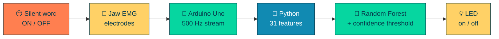

---

## ✨ Hi, I'm Shakthi

I'm a second-year student who likes tech that feels a little like **magic**: moving an LED with a word I never say out loud, flagging fraud as it happens, or getting a model to explain *why* it raised a flag.

I grew up on Pixar and DreamWorks, I draw and edit, and I want to build things at **creative, innovative companies** where code and imagination share a desk. 🎬

---

## 🚀 Things I've built

<table>
<tr>
<td width="50%" valign="top">

### 🤫 NeuroVocal
**Silent-speech interface from jaw muscle signals**

Electrodes on the jaw → Arduino → Python Random Forest → LED.
Silently mouth *"ON"* or *"OFF"* and the light obeys.

🎯 **96.9%** cross-validated accuracy
📊 191 samples · 31 features
🔜 Next: more words, 2nd EMG channel, cross-user tests

   

</td>
<td width="50%" valign="top">

### 🛡️ Fraud Watch
**[mongo-fraud-detection](https://github.com/shakthi-007-sriher/mongo-fraud-detection)**

Fraud detection that lives *inside* MongoDB: change streams, per-user risk scores, a live dashboard and an attack-simulation lab (botnets, card testing, impossible travel).

🕸️ Fraud-ring graph with `$graphLookup`
🧪 443,803-event simulation

   

</td>
</tr>
<tr>
<td width="50%" valign="top">

### 🫁 MultiModalOptTab
**[Explainable early lung cancer detection](https://github.com/shakthi-007-sriher/MultiModelOptTab---Early-Lung-Cancer-detection)**

Team research: a hybrid transformer that fuses CT scans with clinical tabular data, plus uncertainty estimates and explanations, with a Gradio demo.

  

</td>
<td width="50%" valign="top">

### 🧠 Depression Risk Detection
**Research in progress**

Spotting depression risk in social-media posts with deep learning, with explainable AI so the model can show its reasons.

  

</td>
</tr>
</table>

### How NeuroVocal works

---

## 🧰 Toolbox

**Superpowers:** 🧠 Deep learning · 🔍 Explainable AI · 📈 Signal processing · 🗄️ Vector search & RAG · 🎤 Debating

---

## 🌱 Right now

- 🔬 Writing up explainable-AI research (medical imaging, mental health)
- 📘 Deep Learning course · Algorithms · Advanced Java · Full-Stack
- 🧪 Extending NeuroVocal
- 🤝 Leading the **Data Analytics Club** at SRIHER

## 🏅 Wins

🥇 Best Debutant, Loyola College MUN · 💻 Best Performer in C Programming · 🌟 Best Performer in Competency Development

## 📜 Certified

🍃 MongoDB: *RAG with Vector Search* · *AI Agents with MongoDB* · *MongoDB Basics for Students* &nbsp;|&nbsp; 🌐 freeCodeCamp: *Responsive Web Design*

---

### 💌 Building something creative with AI? Let's talk.

I'm looking for **internships & collaborations** in interactive, creative and innovative tech.

